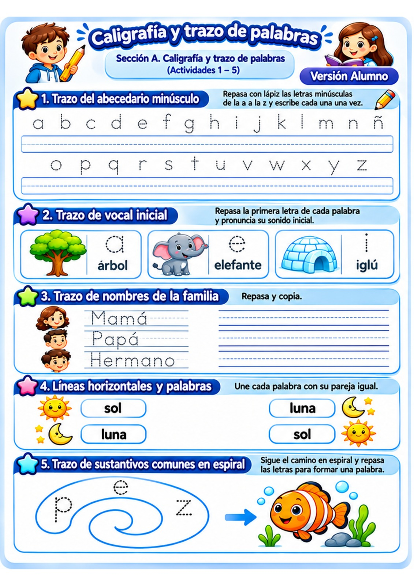
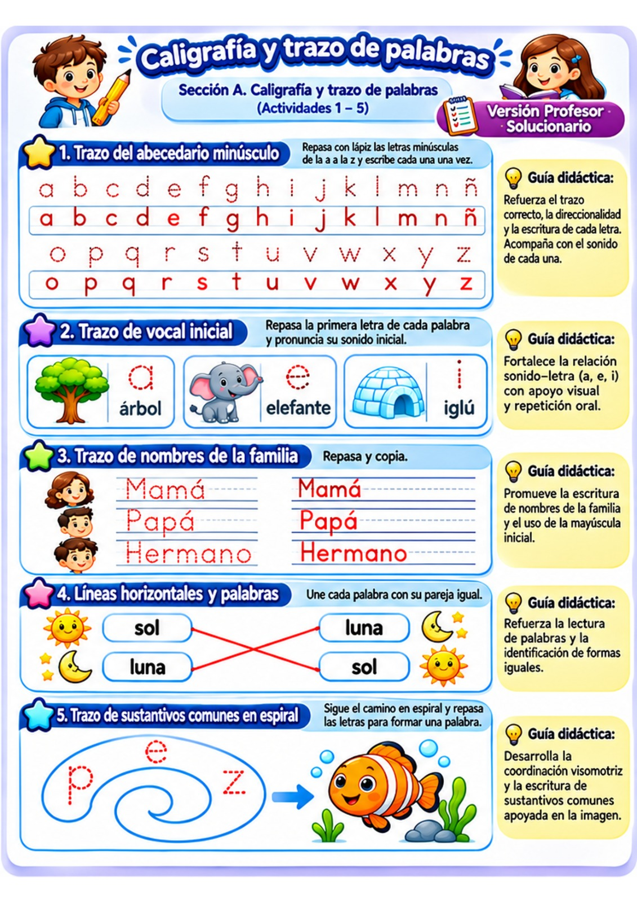

# Guia Imagenes para Actividades

GIA organiza la creación de imágenes para bancos escolares. Cada bloque de cinco actividades tiene una página para el alumno y un solucionario para el profesor. Ambas versiones comparten la misma página base.

## Requisitos

- Python 3.10 o superior. El script usa la biblioteca estándar.
- Un banco de actividades en formato DOCX y un asistente que pueda seguir la guía, maquetar las páginas y generar ilustraciones.

## Uso del script

1. Coloca tu archivo en `Data/`. Para preparar la solicitud, ejecuta desde la raíz:

   ```bash
   python3 gia.py prompt "Data/mi banco.docx"
   ```

2. Envía el texto que imprime el script a tu asistente con acceso al proyecto. El asistente lee la [guía de generación](GUIA_DE_GENERACION.md), crea las parejas y verifica las soluciones y la coincidencia visual. La guía indica cómo guardar los PNG en `Generadas/mi banco/Contenido N/Alumno/` y `Generadas/mi banco/Contenido N/Profesor/`, con nombres como `actividades_01-05.png`.

3. Cuando las páginas hayan pasado la revisión, empaqueta el banco. Indica los números de todos los contenidos del documento. Este ejemplo usa los contenidos 3, 4 y 5.

   ```bash
   python3 gia.py comprimir "Data/mi banco.docx" --contenidos 3 4 5
   ```

   El comando exige 12 PNG por destinatario y contenido y avisa si hay archivos faltantes o adicionales. El resultado es `Comprimidos/mi banco.zip`. El script prepara la solicitud y comprueba la estructura del ZIP. La generación y la revisión pedagógica se hacen según la guía.

## Referencias visuales

Estas páginas muestran el estilo de caligrafía para alumno y profesor. La guía del proyecto define las diferencias permitidas entre ambas versiones.

| Alumno | Profesor |
| --- | --- |
|  |  |
